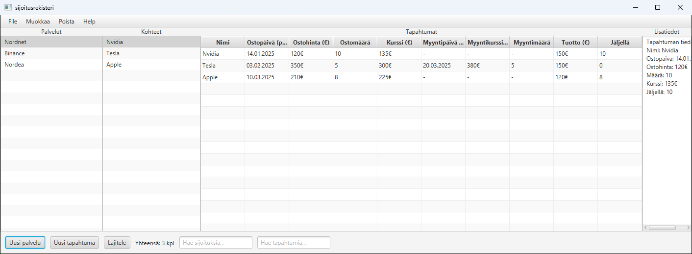

# Sijoitusrekisteri

Työpöytäsovellus omien sijoitusten seurantaan. Sovellukseen kirjataan palvelut, joiden kautta sijoitetaan (esim. Nordnet tai Binance), ja jokaiselle palvelulle sen osto- ja myyntitapahtumat.

Tein sovelluksen Jyväskylän yliopiston **Ohjelmointi 2** -kurssin harjoitustyönä keväällä 2025. Se on toteutettu Javalla ja JavaFX:llä.



## Ominaisuudet

- **Palvelut:** lisäys, uudelleennimeäminen, poisto, haku nimellä ja lajittelu aakkosjärjestykseen
- **Tapahtumat:** osto- ja myyntitapahtumien lisäys, muokkaus ja poisto sekä haku nimellä. Muokkausikkunan saa auki myös tuplaklikkaamalla riviä tai painamalla F2.
- **Taulukkonäkymä:** valitun palvelun kaikki tapahtumat (ostopäivä, ostohinta, määrä, kurssi, myyntitiedot, tuotto ja jäljellä oleva määrä) ja valitun tapahtuman tiedot omassa paneelissaan
- **Syötteiden tarkistus:** esimerkiksi päivämäärien on oltava muotoa `pp.kk.vvvv`, ja virheestä näytetään ilmoitus heti lomakkeella
- **Tallennus tekstitiedostoihin:** tiedot tallennetaan `|`-eroteltuina riveinä, ja edellisestä versiosta tehdään `.bak`-varmuuskopio ennen jokaista tallennusta. Tiedot tallentuvat automaattisesti myös ohjelmaa suljettaessa.
- **Yksikkötestit:** tietorakenneluokille on JUnit-testit

## Tekniikat

- Java 23 (käytössä preview-ominaisuudet)
- JavaFX 23: käyttöliittymä on FXML-näkymissä ja logiikka kontrolleriluokissa
- JYU:n `fxgui`- ja `Ohj2`-kirjastot (`ListChooser`, `StringGrid`, `Dialogs`, `Mjonot`)
- JUnit-testit, jotka on generoitu ComTest-dokumentaatiotesteistä
- Kehitysympäristönä Eclipse

## Käynnistys

Tarvitset **Java 23 -JDK:n, jossa on mukana JavaFX**, esimerkiksi BellSoft Liberica JDK Full tai Azul Zulu JDK FX. Version on oltava täsmälleen 23, koska ohjelma on käännetty Javan preview-ominaisuudet päällä.

Valmiiksi käännetty ohjelma on tiedostossa `sijoitusrekisteri2.jar`.

**Windows:** tuplaklikkaa tiedostoa `kaynnista.bat`.

**Komentoriviltä:** aja projektikansiossa

```
java --enable-preview -jar sijoitusrekisteri2.jar
```

Komento täytyy ajaa projektikansiosta, koska ohjelma lukee datan kansiosta `sijoitusrekisteri/`.

Jos JDK:ssasi ei ole JavaFX:ää, lataa [JavaFX SDK 23](https://gluonhq.com/products/javafx/) ja kerro sen sijainti käynnistyskomennossa:

```
java --enable-preview --module-path <polku>\javafx-sdk-23\lib --add-modules javafx.controls,javafx.fxml -jar sijoitusrekisteri2.jar
```

## Rakenne

```
src/
├── fxSijoitusrekisteri/   Käyttöliittymä: FXML-näkymät, kontrollerit ja käynnistysluokka
└── sijoitusrekisteri/     Tietorakenteet ja tiedostojen käsittely
    └── test/              JUnit-testit
sijoitusrekisteri/         Datatiedostot (sijoitukset.dat, tapahtumat.dat)
kuvat/                     Suunnitelmakuvat ja kuvakaappaukset
```

Ohjelma on jaettu käyttöliittymään ja tietorakenteisiin. Käyttöliittymä käsittelee tietoja vain `Sijoitusrekisteri`-luokan kautta, ja se kokoaa yhteen kaksi säiliöluokkaa:

- `Sijoitukset` säilyttää palvelut (`Sijoitus`) dynaamisesti kasvavassa taulukossa.
- `Tapahtumat` säilyttää osto- ja myyntitapahtumat (`Tapahtuma`) listassa. Jokainen tapahtuma viittaa palveluunsa tunnusnumerolla.

`Tapahtuma` toteuttaa `Tietue`-rajapinnan. Sen ansiosta tapahtuman muokkauslomake rakentuu automaattisesti tietueen kenttien perusteella, eikä jokaista kenttää tarvitse kirjoittaa käyttöliittymään erikseen.

### Tiedostomuoto

`sijoitukset.dat`: ensimmäisellä rivillä taulukon alkukoko, sen jälkeen yksi palvelu riviä kohden.

```
20
1|Nordnet
2|Binance
```

`tapahtumat.dat`: kentät ovat tunnus, palvelun tunnus, nimi, ostopäivä, ostohinta, ostomäärä, kurssi, myyntipäivä, myyntikurssi, myyntimäärä, tuotto ja jäljellä.

```
1|1|Nvidia|14012025|120|10|135|0|0|0|150|10
2|1|Tesla|03022025|350|5|300|20032025|380|5|150|0
```

## Tunnetut rajoitukset

- Rahasummat ja määrät ovat kokonaislukuja, joten desimaaleja (esim. murto-osa bitcoinista) ei voi syöttää.
- Tuotto ja jäljellä oleva määrä syötetään käsin, eikä ohjelma laske niitä automaattisesti.
- Ohjeet eivät ole ohjelman sisällä: Help → Apua avaa harjoitustyön sivun kurssin TIM-ympäristössä.

## Tekijä

Tomas Vallas
